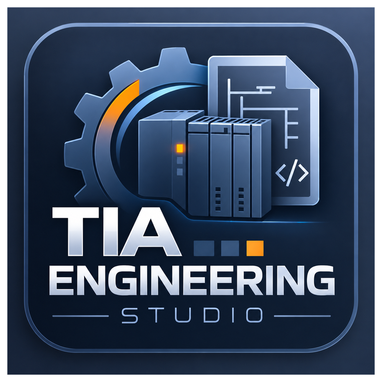

# TIA Engineering Studio

Windows-alapú mérnöki munkaeszköz Siemens **TIA Portal V18, V19 és V20** célrendszerekhez.
Egyetlen verziófüggetlen gépmodellből (JSON) ellenőrzött, determinisztikus SCL-forrásokat generál,
majd a célverzióhoz tartozó, külön folyamatban futó Openness-workerrel **offline, teljes
sandbox-másolatba** importálja és lefordítja őket.

> A program **nem** tölt le PLC-re, nem kapcsolódik online, nem vezérel berendezést, nem forszol, és
> nem generál/módosít safety (F-) logikát. A generált kódot mérnöknek kell ellenőriznie a gép
> dokumentációja és kockázatértékelése alapján.

A teljes követelményrendszer: [`TIA_Engineering_Studio_TIA_V18_V19_V20_Projektleiras_HU.md`](TIA_Engineering_Studio_TIA_V18_V19_V20_Projektleiras_HU.md).

## Állapot

| Rész | Állapot |
|---|---|
| JSON-séma 1.1, közös hibakódok, 63 közös validációs teszteset | kész, tesztelt |
| Python SCL-generátor (determinisztikus, golden-fájlos tesztek V18/V19/V20-ra) | kész, tesztelt |
| Rust validátor (C ABI, P/Invoke) | kész, tesztelt (a C#-validátorral esetenként egyező kimenet) |
| C# Domain / Contracts / Application (állapotgép, jóváhagyás) / Infrastructure | kész, unit- és integrációs tesztekkel |
| Worker-logika (TiaAdapter.Common): előfeltételek, sandbox, hash, jóváhagyás, rekurzív ütközésvizsgálat | kész, hamis Openness-backenddel tesztelve |
| V18/V19/V20 worker + V18 API-szintű Openness-implementáció | megírva; **valódi TIA Portallal még nincs igazolva** |
| Blokk-könyvtárak: export projektből (SCL-forrás / SimaticML), import a jóváhagyási láncon | kész, hamis Openness-backenddel tesztelve; valódi TIA-val igazolandó |
| WPF Desktop | megírva; a XAML csak Windows alatt fordul (CI: `windows-latest`) |

**Fontos:** a V18/V19/V20 Openness-integráció a spec 11.4 szerint csak akkor tekinthető
kompatibilisnek, ha a `scripts/test-tia-integration.ps1` mindhárom verzióra dokumentáltan lefutott
(lásd [`docs/COMPATIBILITY_MATRIX.md`](docs/COMPATIBILITY_MATRIX.md)). Jelenleg egyik verzióra sincs
ilyen eredmény; a felület ezért a telepített verziókat `Not tested` állapottal mutatja.

## Szerkezet

```text
contracts/            JSON-sémák (gépmodell, worker-parancs/-eredmény, manifest, blokk-könyvtár), error-codes.json
examples/             machine-v18.json, machine-v19.json, machine-v20.json
python/generator/     SCL-generátor (Python 3.9+, külső függőség nélkül) + templates/
rust/tes_validator/   determinisztikus validátor, natív x64 DLL (C ABI)
src/
  TiaStudio.Domain/              Siemens-független gépmodell, szabály-primitívek, állapotgép
  TiaStudio.Contracts/           DTO-k, hibakódok, manifest/sandbox/jóváhagyás-integritás
  TiaStudio.Application/         munkafolyamat (DRAFT → … → SAVED), port interfészek
  TiaStudio.Infrastructure/      C#-validátor, Rust P/Invoke, Python-folyamat, registry, worker IPC, napló
  TiaStudio.TiaAdapter.Common/   worker végrehajtási sorrend, Siemens-típusmentes absztrakció
  TiaStudio.TiaAdapter.OpennessShared/  V18 API-szintű Openness-kód (a workerekbe fordul)
  TiaStudio.TiaAdapter.V18|V19|V20/     net48 x64 worker EXE, saját Siemens.Engineering.dll-lel
  TiaStudio.Desktop/             WPF felület (net48 x64)
tests/
  Contracts/validation-cases.json   közös esetek: C#, Python és Rust is ezt futtatja
  GoldenScl/V18|V19|V20/            elvárt SCL-bájtok
  Unit/TiaStudio.UnitTests/         C# unit tesztek (TIA nélkül)
  Integration/TiaStudio.IntegrationTests/  Rust DLL, Python-folyamat, teljes munkafolyamat; valódi TIA env-vel
scripts/              bootstrap, build-*, configure-workers, check-environment, test-*
docs/                 architektúra, szerződések, biztonság, kompatibilitás, verziónkénti leírások, üzemeltetés
```

## Felület

A kezelőfelület a TIA Portal portál nézetének színvilágát követi: fekete fejléc türkiz kiemeléssel,
sötét palaszürke bal oldali navigációs csempék (a kiválasztott világos, narancs jelölővel), kékesszürke
műveleti oszlop fogaskerék-vízjellel és pont-hivatkozásokkal, világosszürke munkaterület kártyákkal.
Minden vezérlő saját sablont kap (`src/TiaStudio.Desktop/Themes/PortalTheme.xaml`): egyedi ablakkeret
(WindowChrome) saját címsor-gombokkal, gombok, beviteli mezők, legördülő listák, táblázatok,
görgetősávok, folyamatjelző és a megerősítő/hibaablak (`ThemedDialog`) is. A felső sáv a munkafolyamat
lépéseit mutatja (kész: türkiz, aktuális: narancs, hibás: piros).

Indításkor a nyitóképen előbb a logó ikonja ugrik be és felragyog, majd felcsúszik és átúszik a
teljes logóba, amelynek felirata (TIA / ENGINEERING / STUDIO) fentről lefelé tárul fel; ezután a
nyitókép finoman elhalványul, és megjelenik a kezdőlap. Ha a Windows animációi ki vannak kapcsolva, a
sorozat gyorsítva fut; `--no-splash` kapcsolóval kihagyható.

Képernyőképek: `TiaStudio.Desktop.exe --screenshot <mappa> [--demo examples\machine-v18.json]`
ideiglenes mappákkal minden szekciót PNG-be ment (TIA Portalt nem indít). A CI Windows-jobja ezt
minden pushnál lefuttatja; a képek a `ui-screenshots` ágon és a `ui-screenshots` artifactban
érhetők el. A logóváltozatok (keretes, körvonalas és keret nélküli
ikon, teljes logó, app-ikon) a `docs/assets/brand` mappában vannak; az alkalmazásikont (`app.ico`) és a
felület képeit a `scripts/tools/build_brand_assets.py` állítja elő belőlük.

## Gyors kezdés (Windows)

Előfeltételek: Windows x64, Visual Studio 2022 vagy .NET SDK 8 + **.NET Framework 4.8 Developer Pack**,
Python 3.9+, Rust stable (`x86_64-pc-windows-msvc`). TIA-művelethez: a célverzió TIA Portal + Openness,
licenc, és a felhasználó a `Siemens TIA Openness` helyi csoport tagja.

```powershell
.\scripts\bootstrap.ps1
.\scripts\check-environment.ps1
.\scripts\test-offline.ps1
.\scripts\build-desktop.ps1          # -> dist\TiaEngineeringStudio
.\dist\TiaEngineeringStudio\TiaStudio.Desktop.exe
```

A workerek a build-gépen a registryből megtalált `Siemens.Engineering.dll`-re hivatkoznak (a DLL-t
nem másoljuk). Ha egy verzió nincs telepítve, az adott worker „unlinked" módban épül, és minden
TIA-műveletet `WORKER_BUILT_WITHOUT_OPENNESS` hibával utasít el. Másik gépre telepítés után:

```powershell
.\scripts\configure-workers.ps1 -WorkersRoot .\dist\TiaEngineeringStudio\workers
```

## Parancssor (TIA nélkül)

```powershell
cd python
python -m unittest discover -s tests -v
python -m generator.main --input ..\examples\machine-v18.json --output ..\generated\v18-demo

cd ..\rust\tes_validator
cargo test
cargo build --release
```

Linuxon/CI-ben: `bash scripts/test-offline.sh` (a WPF projekt kivételével mindent fordít és tesztel).

## Munkafolyamat

`DRAFT → VALIDATED (C#) → CHECKED (Rust) → GENERATED (Python + SHA-256 manifest) → REVIEWED (minden
fájl megnyitva az előnézetben) → APPROVED (konkrét sandbox + hash-ekhez kötött jóváhagyás) →
READY_TO_IMPORT (verzió-felderítés + száraz futás, rekurzív ütközésvizsgálat) → IMPORTED → COMPILED → SAVED`.
Bármely hiba `FAILED`; onnan csak újrakezdés (DRAFT) vezet tovább. Részletek:
[`docs/ARCHITECTURE.md`](docs/ARCHITECTURE.md), [`docs/OPERATIONS.md`](docs/OPERATIONS.md).

## Dokumentáció

- [Architektúra](docs/ARCHITECTURE.md) · [API-szerződések](docs/API_CONTRACTS.md) · [Validációs szabályok](docs/VALIDATION_RULES.md)
- [Biztonsági szabályok](docs/SECURITY_RULES.md) · [Kompatibilitási mátrix](docs/COMPATIBILITY_MATRIX.md)
- [TIA V18](docs/TIA_V18.md) · [TIA V19](docs/TIA_V19.md) · [TIA V20](docs/TIA_V20.md)
- [Blokk-könyvtárak](docs/BLOCK_LIBRARY.md) · [Üzemeltetés](docs/OPERATIONS.md) · [Ütemterv és döntési napló](docs/ROADMAP.md)
